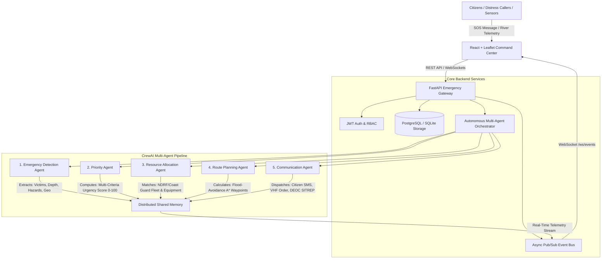

# 🌊 Agentic AI Based Autonomous Flood Disaster Response and Rescue Coordination System

[-red.svg)](#)
[](#)
[](#)
[](#)
[](#)
> 📖 **Team Members & Evaluators Guide:** For an exhaustive, deep-dive architectural and operational explanation of every agent, formula, file, database model, and setup instructions, refer to **[`PROJECT_EXPLANATION.md`](./PROJECT_EXPLANATION.md)**.

---

## 🏛️ Executive Summary & Abstract

Catastrophic flood disasters present extreme challenges for emergency management authorities: rapid water level fluctuations, overwhelmed emergency dispatch switchboards, severed communication links, impassable road networks, and severely limited rescue personnel. 

The **Agentic AI Based Autonomous Flood Disaster Response and Rescue Coordination System** is a next-generation, production-grade cyber-physical emergency operations platform. Designed under the operational guidelines of the **National Disaster Management Authority (NDMA)**, the system leverages a collaborative multi-agent architecture powered by **CrewAI** and **FastAPI** to automate the end-to-end disaster response lifecycle:
1. **Converting chaotic citizen SOS messages** into verified, structured spatial incidents.
2. **Prioritizing rescue urgency** using mathematical Multi-Criteria Decision Analysis (MCDA).
3. **Optimizing rescue resource allocation** across specialized aquatic, amphibious, and aerial squads.
4. **Calculating flood-avoidance transit corridors** to bypass submerged chokepoints and structural hazard zones.
5. **Broadcasting multi-channel emergency directives** across public SMS, responder VHF radio channels, DEOC situational logs, and relief camp intake coordinators.

---

## 📐 System Architecture



---

## 🤖 The 5 CrewAI Specialized Agents

| # | Agent Name | Role | Core Goal & Algorithm |
|---|------------|------|-----------------------|
| **1** | **Emergency Detection Agent** | Distress Ingestion & NLP Extraction | Ingests frantic, unstructured distress text. Parses victim counts (adults, infants, elderly, injured), water depth in meters, landmark extraction, and hazard flags (*Submerged Power Lines, Rapid Currents, Attic Trapping*). |
| **2** | **Priority Agent** | Disaster Risk & MCDA Triage Commander | Executes Multi-Criteria Decision Analysis (MCDA) to calculate a unified priority score ($0 - 100$) and assigns urgency classification (`CRITICAL`, `HIGH`, `MEDIUM`, `LOW`) with strict dispatch SLAs. |
| **3** | **Resource Allocation Agent** | Rescue Logistics & Fleet Dispatcher | Evaluates real-time fleet manifests across **NDRF**, **SDRF**, **Coast Guard**, and **Medical Teams**. Matches boat capacity, amphibious capability, and distance to assign the optimal unit. |
| **4** | **Route Planning Agent** | Tactical GIS & Evacuation Navigator | Analyzes live hydrographic flood risk polygons. Identifies submerged road bottlenecks and charts safe transit waypoints connecting Team Base $\rightarrow$ Incident $\rightarrow$ Nearest Safe Relief Shelter. |
| **5** | **Communication Agent** | Tactical & Public Safety Communications | Generates 4 synchronized communication payloads: Citizen reassurance SMS with ETA, Team VHF Tactical Dispatch Order, DEOC Situation Report (SITREP), and Relief Shelter Pre-Arrival Intake Advisory. |

### 🧮 Mathematical Formulation of Priority Scoring (MCDA)

$$\text{Priority Score} = \min\Big(100, \, S_{\text{depth}} + S_{\text{vulnerability}} + S_{\text{hazards}}\Big)$$

Where:
- **Water Depth Factor ($S_{\text{depth}} \le 30$):**
  $$S_{\text{depth}} = \begin{cases} 30 & \text{if } \text{depth} \ge 2.5\text{m} \\ 22 & \text{if } 1.5\text{m} \le \text{depth} < 2.5\text{m} \\ 14 & \text{if } 0.8\text{m} \le \text{depth} < 1.5\text{m} \\ 6 & \text{otherwise} \end{cases}$$
- **Vulnerability Factor ($S_{\text{vulnerability}} \le 40$):**
  $$S_{\text{vulnerability}} = \min\big(40, \, 6 \cdot N_{\text{elderly}} + 5 \cdot N_{\text{children}} + 10 \cdot N_{\text{injured}} + 1.5 \cdot N_{\text{total}}\big)$$
- **Hazard Multipliers ($S_{\text{hazards}} \le 30$):**
  $$S_{\text{hazards}} = \sum_{h \in \text{Hazards}} W_h \quad (W_{\text{electric}}=15, \, W_{\text{collapse}}=18, \, W_{\text{oxygen}}=20, \, W_{\text{current}}=12)$$

---

## 🗄️ Shared Memory & Database Schema

The system maintains real-time synchronization between in-memory agent state and relational persistent storage:

1. **`incidents`**: Distress call transcript, extracted demographics, priority scores, assigned rescue team, and designated relief camp.
2. **`teams`**: Battalion callsign, agency (`NDRF`, `SDRF`, `COAST_GUARD`, `MEDICAL_CORPS`), live GPS coordinates, inventory (`boats_count`, `amphibious_vehicles`, `drones_count`, `medical_kits`), and radio frequencies.
3. **`flood_sensors`**: Hydrologic gauging stations, water levels, danger/warning thresholds, 3-hour rainfall totals, and rising/receding trends.
4. **`relief_camps`**: Highland emergency shelters, total capacity, current occupancy, available beds, dry food ration packets, and medical officers on-site.
5. **`rescue_routes`**: Calculated waypoint vectors (GeoJSON coordinate arrays), distance in kilometers, estimated transit time in minutes, and flood risk rating.
6. **`agent_logs`**: Step-by-step audit trace recording agent thoughts, actions, input payloads, output responses, confidence metrics, and execution latency in milliseconds.
7. **`users`**: Role-based access control (`admin`, `commander`, `field_responder`, `camp_coordinator`) with bcrypt password hashing and JWT authentication.

---

## 🖥️ Government-Style Command Center (React + Leaflet)

The UI is built with a high-contrast, military/defense-grade **Emergency Operations Center (EOC)** theme:
- **Top Command Bar**: Live DEFCON 4 Red Alert banner, synchronized UTC clock, active incident counters, and one-click Emergency SOS dispatch.
- **Geospatial Tactical Radar (Leaflet)**:
  - Hydrographic risk zones with translucent color-coded polygons (Extreme, High, Moderate, Safe).
  - Pulsing red distress markers for Critical incidents.
  - Agency-badged responder markers (NDRF, Coast Guard, Medical).
  - Relief shelter icons with real-time bed capacity meters.
  - Calculated safe route polylines bypassing flood chokepoints.
- **CrewAI Multi-Agent Live Terminal**:
  - Live horizontal ribbon displaying the 5 agents with state indicators.
  - Streaming thought-process log showing step-by-step reasoning, tool execution, confidence levels, and milliseconds latency.
  - Expandable JSON payload inspector for transparent algorithmic audit.
- **Incident Command Triage Queue**: Filterable by Critical, Dispatched, or Rescued status with manual pipeline execution triggers.
- **Rescue Fleet Matrix**: Real-time asset inventory and readiness status controls.
- **Relief Camp Shelter Manager**: Live capacity progress bars and quick evacuee intake counter.
- **River Basin Hydro Network**: Real-time river gauges with interactive water rise simulation button.
- **Preset Emergency Scenarios**: One-click simulation for instant demonstration:
  - *Hospital ICU Basement Inundation*
  - *School Bus Marooned in Flash Flood*
  - *Residential Roof Structural Collapse*
  - *Slum Colony Inundation*

---

## 🚀 Quickstart Guide

### Prerequisites
- **Node.js**: v18+ (Tested on v24)
- **Python**: 3.10, 3.11, 3.12, 3.13, or 3.14
- **Docker & Docker Compose** (Optional, for containerized deployment)

---

### Option A: One-Click Bare-Metal Run (Fastest)

Before starting, copy `.env.example` to `backend/.env` and set `SECRET_KEY` to a
random value of at least 32 characters. Generate one with
`python -c "import secrets; print(secrets.token_urlsafe(32))"`. Keep `.env` files
private; they are excluded from Git.

#### On Windows:
Double-click `run_dev.bat` or run:
```powershell
.\run_dev.bat
```

#### On Linux / macOS:
```bash
chmod +x run_dev.sh
./run_dev.sh
```

---

### Option B: Manual Step-by-Step Setup

For Docker Compose, copy `.env.example` to the project-root `.env` and set both
`SECRET_KEY` and `POSTGRES_PASSWORD` to unique random values before starting the
services. Use URL-safe values for the database password because it is included
in `DATABASE_URL`.

#### 1. Backend Setup
```bash
cd backend
python -m venv .venv

# On Windows:
.venv\Scripts\activate
# On Linux/macOS:
source .venv/bin/activate

pip install -r requirements.txt

# Start the FastAPI server (Initializes and seeds DB automatically)
uvicorn app.main:app --host 127.0.0.1 --port 8000 --reload
```
- API Base: `http://127.0.0.1:8000`
- Interactive Swagger Docs: `http://127.0.0.1:8000/docs`

#### 2. Frontend Setup
```bash
cd frontend
npm install
npm run dev
```
- Dashboard URL: `http://localhost:5173`

---

### Option C: Docker Compose Multi-Container Deployment

```bash
docker-compose up --build
```
This spins up:
- `db`: PostgreSQL 16 Alpine container with persistent healthchecks.
- `backend`: FastAPI + CrewAI container connected via asyncpg.
- `frontend`: React + TypeScript application served via Nginx with API/WebSocket reverse proxy.

---

## 📡 REST API Reference

| Method | Endpoint | Description |
|--------|----------|-------------|
| `POST` | `/api/v1/incidents/sos` | Ingests raw citizen SOS distress text; executes the 5-Agent pipeline immediately. |
| `GET` | `/api/v1/incidents` | Lists all incidents with optional `status` and `priority` query filters. |
| `GET` | `/api/v1/incidents/{id}` | Returns comprehensive incident view with assigned team and safe route waypoints. |
| `PATCH` | `/api/v1/incidents/{id}/status` | Updates incident status (`IN_PROGRESS`, `RESCUED`, `RESOLVED`). |
| `GET` | `/api/v1/agents/status` | Reports operational health and capabilities of the 5 CrewAI agents. |
| `GET` | `/api/v1/agents/logs` | Returns chronological agent reasoning thoughts, actions, and latency metrics. |
| `POST` | `/api/v1/agents/trigger/{id}` | Manually triggers the 5-Agent pipeline for an existing incident. |
| `GET` | `/api/v1/teams` | Returns rescue battalion fleet readiness, inventory, and GPS coordinates. |
| `PATCH` | `/api/v1/teams/{id}/status` | Updates team status (`AVAILABLE`, `DISPATCHED`, `ON_MISSION`). |
| `GET` | `/api/v1/flood/sensors` | Returns live river gauging stations, danger marks, and rainfall totals. |
| `POST` | `/api/v1/flood/sensor/{id}/telemetry` | Ingests/simulates a water level surge at a specific sensor station. |
| `GET` | `/api/v1/flood/zones` | Returns GeoJSON polygon boundaries and flood depth for map rendering. |
| `GET` | `/api/v1/camps` | Returns all safe relief shelters, occupancy rates, and medical supplies. |
| `PATCH` | `/api/v1/camps/{id}/intake` | Records arrival of evacuees and updates available bed counts. |
| `WS` | `/ws/events` | Bi-directional WebSocket stream broadcasting live agent thoughts and state updates. |

---

## 🧪 Testing & Verification

The project includes an automated test suite verifying each individual agent and GIS calculations:

```bash
cd backend
.venv\Scripts\activate
pytest -v
```

### Test Suite Coverage:
- `test_emergency_detection_agent`: Validates NLP keyword parsing, casualty extraction, and hazard classification.
- `test_priority_agent`: Validates mathematical boundary conditions of the MCDA scoring formula.
- `test_resource_allocation_agent`: Validates boat capability requirements for deep flood waters and proximity scoring.
- `test_gis_calculations`: Validates Haversine distance accuracy and flood-avoidance waypoint generation.

---

## 🎓 Final-Year Engineering Project Defense & Viva Notes

When presenting this project for academic or defense evaluation:
1. **Agent Autonomy**: Highlight that the system is not a simple CRUD dashboard; the 5 agents act autonomously in sequence, passing state through shared memory and making decisions without human bottlenecking.
2. **Dual-Engine Resilience**: Explain the hybrid architecture: it fully defines official CrewAI agents and tasks, while offering an offline deterministic autonomous engine so that defense centers function even when external internet or API access is severed during floods.
3. **Multi-Disciplinary Integration**: Point out the combination of **Natural Language Processing (NLP)**, **Operations Research (MCDA Scoring)**, **Geospatial Information Systems (GIS Pathfinding)**, and **Distributed WebSockets**.

---

## 📜 License & Acknowledgments
Built for educational research and national emergency preparedness. Developed in alignment with NDMA guidelines.
